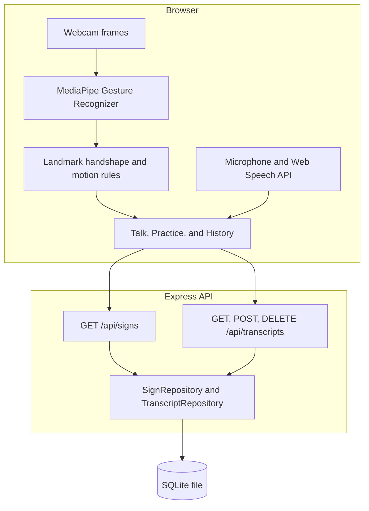

# Architecture

SignConnect is one web page and one API. The page recognizes signs and speech. The API stores the sign list and saved conversations in SQLite.

## Client

`CameraView` grabs frames and asks `createRecognizer()` for a label. The recognizer is `CompositeRecognizer`:

1. MediaPipe returns landmarks, handedness, and one of its canned gestures: open palm, thumbs up, thumbs down, I-love-you, victory, pointing up, closed fist.
2. `classifyStaticSign` reads those landmarks. Two-hand signs (HELP, GOOD, FRIEND, NAME, FAMILY, LOVE, WHAT, DONE) are checked first. A single hand is then matched to a letter, a number, or BAD. Flat O that is not a tighter letter shape is MORE.
3. `GestureTracker` watches the wrist and fingertips for PLEASE, THANK YOU, SORRY, EAT, DRINK, WHERE, WATER, J, and Z. A motion label stays up long enough for the one-second hold to commit the word, then the similar canned gesture is ignored for a short time so it is not added immediately after.

`useSentenceBuilder` turns a steady label into a word. Speech and typing call `addText` and skip the hold, because the phrase is already finished. Both paths append to the same word list.

Practice and History do not keep their own copy of the vocabulary or the saved rows. They render what `GET /api/signs` and the transcript routes return.

## Server

Routes depend on `SignRepository` and `TranscriptRepository` (`server/src/repositories/types.ts`). `server/src/index.ts` opens SQLite and passes `SqliteSignRepository` and `SqliteTranscriptRepository`. On startup the schema is created if needed and the sign rows are upserted from `SEED_SIGNS`. Conversations already in the file are left alone.

The default file is `server/data/signconnect.sqlite`. `DATABASE_PATH` overrides it. `:memory:` is a database that disappears when the process exits.

## What is intentionally not here

There is no account system and no separate deployment config. Another database can implement the same repository interfaces and be constructed in `index.ts`.
