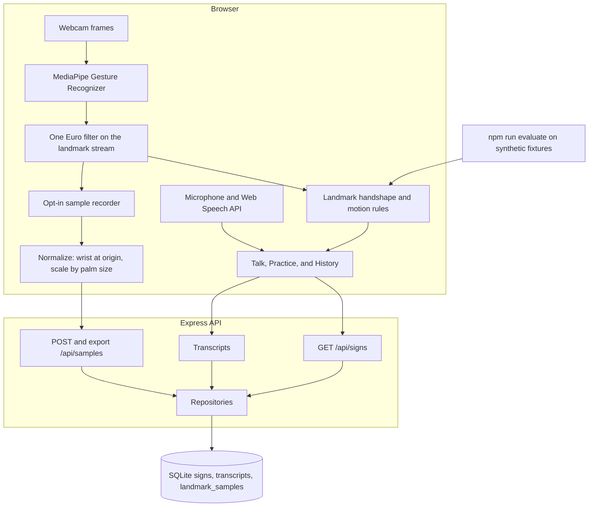

# Architecture

SignConnect is one web page and one API. The page recognizes signs and speech. The API stores the sign list, saved conversations, and optional landmark samples in SQLite.

## Client

`CameraView` grabs frames and asks `createRecognizer()` for a label. The recognizer is `CompositeRecognizer`:

1. MediaPipe returns landmarks, handedness, and one of its canned gestures: open palm, thumbs up, thumbs down, I-love-you, victory, pointing up, closed fist.
2. A one-euro filter smooths each hand's landmarks before the rules run. A large wrist jump resets the filter so two hands are not blended.
3. `classifyStaticSign` reads those landmarks. Two-hand signs (HELP, GOOD, FRIEND, NAME, FAMILY, LOVE, WHAT, DONE) are checked first. A single hand is then matched to a letter, a number, or BAD. Flat O that is not a tighter letter shape is MORE.
4. `GestureTracker` watches the wrist and fingertips for PLEASE, THANK YOU, SORRY, EAT, DRINK, WHERE, WATER, J, and Z. A motion label stays up long enough for the hold rule to commit the word, then the similar canned gesture is ignored for a short time so it is not added immediately after.

`useSentenceBuilder` turns a steady label into a word. The hold is 600 ms and the confidence floor is 0.7, chosen from the sweep in [RESULTS.md](RESULTS.md). Speech and typing call `addText` and skip the hold, because the phrase is already finished.

Practice lists the signs from `GET /api/signs`. History reads and deletes transcripts. The recorder on Practice is off until someone starts it. While it is on, landmarks are smoothed with an exponential moving average, normalized (wrist at the origin, divided by palm size), and posted to `/api/samples`.

## Server

Routes depend on repository interfaces (`server/src/repositories/types.ts`). `server/src/index.ts` opens SQLite and passes the SQLite repositories. On startup the schema is created if needed and the sign rows are upserted from `SEED_SIGNS`. Conversations and recorded samples already in the file are left alone.

The default file is `server/data/signconnect.sqlite`. `DATABASE_PATH` overrides it.

## Evaluation

`npm run evaluate` reads `client/src/recognition/fixtures/synthetic-hands.json`. Those poses come from the kinematic model, not from a camera. The script writes accuracy, precision, recall, a confusion matrix, latency, and the hold/confidence sweep to [RESULTS.md](RESULTS.md).

## What is intentionally not here

There is no account system and no separate deployment config. Another database can implement the same repository interfaces and be constructed in `index.ts`.
